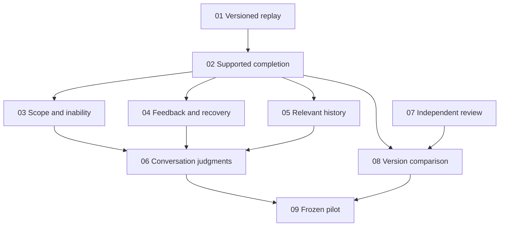

# Criteria-revision tickets

Status: Published and implementation authorized by the user.

Source: [approved feature specification](../spec.md).
The user approved the breakdown by requesting implementation of every ticket.
All nine tickets are implemented, verified and available for review. The frozen
comparison completed with 12 Satisfied, 15 Dissatisfied, 66 Neutral, 7 skipped and
0 errors. Independent human validation remains pending.

| Ticket | Blocked by | Independently verifiable delivery |
| --- | --- | --- |
| [01 — Replay evaluations by their declared rule version](01-versioned-replay.md) | None | Archived version 2 evaluations retain their behavior through the public replay/evaluation boundary; unsupported versions fail visibly. |
| [02 — Recognize supported completion without feedback](02-supported-completion.md) | 01 | A supported complete report or draft can become inferred Satisfied through evaluation and saved reports, without invented acceptance. |
| [03 — Respect essential scope and honest inability](03-essential-scope-and-inability.md) | 02 | Missing optional data, genuine inability, accepted scope changes and proven essential failures produce their agreed distinct outcomes. |
| [04 — Preserve feedback, contradictions and scoped recovery](04-feedback-and-recovery.md) | 02 | Direct acceptance, courtesy, productive use, contradictory facts and rejection recovery remain correctly distinguished in persisted results. |
| [05 — Evaluate goals using relevant captured history](05-relevant-history.md) | 02 | A self-contained goal can be judged despite unrelated omissions; relevant missing history and actual source errors remain distinct. |
| [06 — Judge complete conversations with scoped overall feedback](06-conversation-judgments.md) | 03, 04, 05 | Real multi-goal evaluation preserves each goal and applies mixed-goal, overall-feedback and explicit-priority rules correctly. |
| [07 — Assess reviewer agreement without label leakage](07-independent-review.md) | None | Predictions produce a blind review packet; saved independent reviews produce metrics and a pass, fail or pending gate. |
| [08 — Explain old/new results on frozen sources](08-version-comparison.md) | 02, 07 | Saved old/new evaluations produce reconciled transitions and provenance, with independent validation status reported separately. |
| [09 — Demonstrate the revision on the frozen 100 sessions](09-frozen-pilot.md) | 06, 08 | The complete revised policy runs on the preserved cohort, producing an audited private comparison and explicit remaining validation limits. |

The first ticket is the necessary narrow prefactoring: current replay attaches
version metadata but does not dispatch the rule implementation by that version.
It makes historical preservation demonstrable before adding revised behavior.
No broad refactor or expand–contract migration is needed for this package.

Tickets 01 and 07 can start independently: reviewer tooling uses the existing
saved-prediction interface and does not need the new criteria implemented first.
After 02, tickets 03, 04 and 05 can proceed independently. Ticket 06 integrates
their actual goal behaviors rather than testing aggregation only with fabricated
labels. Ticket 08 can be delivered before the full policy is complete; the real
pilot waits for both policy integration and comparison reporting.

All implementation tickets include their own workflow/replay tests and keep
checks green. Tests, contracts and evidence extraction are part of each behavioral
slice, not separate horizontal tickets. Human annotations do not block building
the reviewer tooling or the exploratory comparison; absent reviews keep the
independent validation gate pending.

## User-story coverage

| Ticket | Primary spec stories |
| --- | --- |
| 01 | 32, 37, 38 |
| 02 | 1–3, 8, 20, 33–36 |
| 03 | 10–19, 21 |
| 04 | 4–9, 24–27 |
| 05 | 22–23, 32, 35 |
| 06 | 28–31 |
| 07 | 42–45, 47–48 |
| 08 | 38–41, 46, 48 |
| 09 | 33, 35–36, 39–48 |

Shared stories deliberately recur where a later integration verifies behavior
introduced earlier. All 48 source stories have an owning delivery slice.
